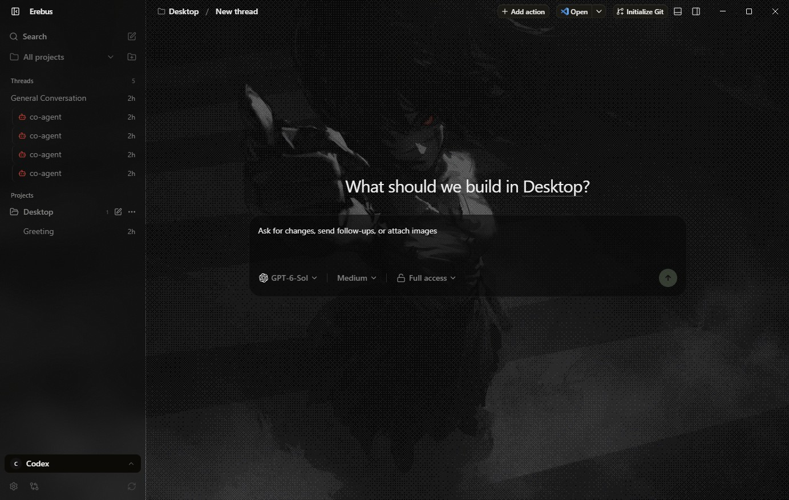
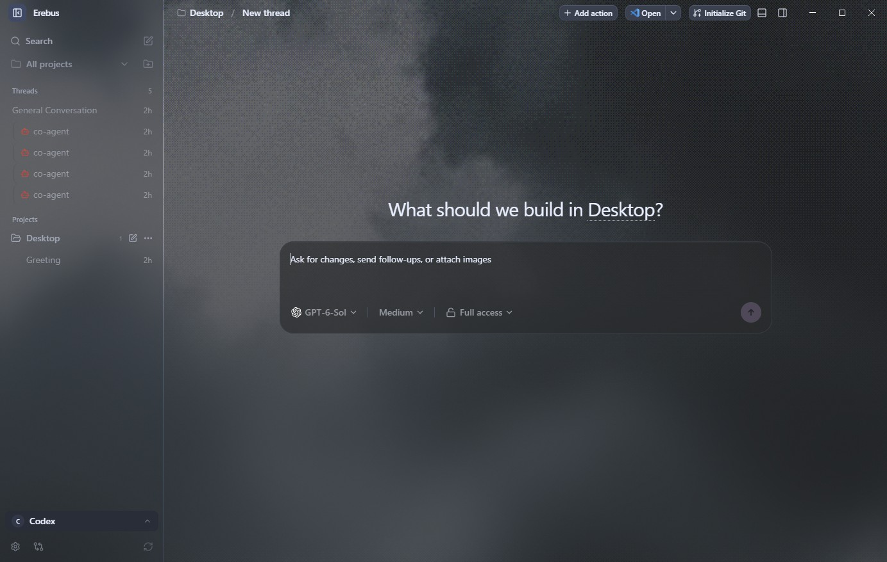

# Erebus

[](https://github.com/Vyntra-Research/Erebus/releases/latest)
[](https://github.com/Vyntra-Research/Erebus/actions/workflows/ci.yml)
[](./LICENSE)

Erebus is a local desktop harness for long-running offensive security research with Codex. It keeps research context durable, coordinates parallel work, manages more than one Codex account, and gives finished findings an independent technical review without forcing the research into campaigns or audit checklists.

The current release runs on Windows and x64 Linux. Codex is the supported provider.

<p align="center">
  
  
</p>

## What Erebus adds

### A research runtime, not an audit workflow

- Keeps compact offensive-research rules in the principal and co-agent context. They cover realistic attacker control, evidence scope, deduplication, natural exploit chains, conclusion reopening, and Post-AI blind spots.
- Uses the native Codex goal as the only visible objective and progress lifecycle. Erebus has no active campaign or Observer layer.
- Offers the optional Capri persona for a more direct, independent, and focused research style without changing the evidence bar or permission model.
- Installs [Argos](https://github.com/rafabd1/Argos) as the connected research map. Each project keeps its graph under `.argos/`.
- Exposes legacy Proteus records through a managed read-only bridge. Erebus does not load Proteus skills or allow Proteus writes.

### Independent finding review

- Submits a finding document and its working PoC to a separate Judge.
- Stores each verdict and delivers it in a later turn, so the evaluator does not steer the original research.
- Supports revisions without replacing the prior evaluation record.
- Calculates explicit CVSS 3.0, 3.1, and 4.0 vectors through `research.calculate_cvss`.

### Parallel work without losing the main thread

- Runs up to four Erebus co-agent threads on separate research surfaces.
- Lets each Codex task use its native subagents for narrower work inside that surface.
- Folds completed co-agent handbacks, resolved approvals, and tool logs into the run that produced them.
- Keeps native goals visible above the composer with pause, resume, and delete controls.

### Long-running Codex sessions

- Keeps steering messages transient across Codex compaction so older directions remain history instead of becoming fresh instructions.
- Resumes large threads without loading the full transcript into the UI or provider process.
- Preserves the thread when an account changes, disappears, or reaches its usage limit.
- Shows the agent's internal browser in a dismissible preview and keeps terminal, diff, checkpoint, and revert tools beside the conversation.

### Multiple Codex accounts

- Keeps account credentials separate while sharing Erebus sessions, configuration, MCPs, skills, and plugins.
- Tracks quota per account and routes each new model request by primary priority, remaining quota, and available credits.
- Applies priority changes during an active task. A request rejected before streaming can retry through another usable account.
- Supports current Codex model options, reasoning effort, speed, and Daybreak when the selected account exposes it.

### Threads, projects, and Git sync

- Creates standalone threads without a project. Link one later from its menu or drag it into a project.
- Keeps active and settled primary thread history in a Git remote chosen by the user. Archived, deleted, and co-agent threads do not enter the mirror.
- Handles conflicts per thread: use the remote history, keep both as separate threads, or replace that remote thread.
- Keeps project paths device-local. A thread imported on another machine stays standalone until it is mapped to a local folder.
- Removes deleted thread history, released co-agent data, stale browser caches, and unused standalone workspaces. Diagnostics can compact reclaimable SQLite space while no turn is active.

### Local workspaces and source control

- Opens a local folder, clones a Git repository, or creates a standalone workspace for a new thread.
- Connects GitHub, GitLab, Bitbucket, and Azure DevOps for repository browsing and pull request work.
- Keeps terminal, file search, source diff, hidden turn checkpoints, and revert controls next to the conversation.
- Supports image attachments, commands, skills, custom keybindings, and permission modes from supervised approval to full access.

### A desktop that can be made yours

- Includes themes, contrast, glass opacity, font controls, and device-local wallpapers.
- Applies dither, dot-screen, and progressive bottom-blur effects over the wallpaper.
- Can derive a readable interface palette from the current image.
- Ships desktop updates through separate Stable and Beta channels.

## Install

Download the Windows x64 installer or Linux x64 AppImage from [GitHub Releases](https://github.com/Vyntra-Research/Erebus/releases/latest).

You need:

- Windows 10 or newer, or a current x64 glibc-based Linux distribution
- Git for repository projects and thread sync
- a ChatGPT account with Codex access
- the Codex CLI on `PATH`

On Linux, make the AppImage executable before opening it:

```sh
chmod +x Erebus-*.AppImage
./Erebus-*.AppImage
```

GTK 3 tools, `xdg-utils`, and an active Secret Service are required on Linux. GNOME Keyring and KWallet are supported.

Open **Settings > Providers > Codex** to sign in. Erebus stores the account in its own profile and does not reuse or modify the Codex desktop app profile.

## Documentation

- [Install and first run](./docs/user/install.md)
- [Codex accounts, routing, models, and personas](./docs/user/providers-codex.md)
- [Research context, co-agents, CVSS, and Judge review](./docs/user/research-supervision.md)
- [Standalone threads and project organization](./docs/user/thread-sidebar.md)
- [Thread history sync through Git](./docs/user/thread-sync.md)
- [Appearance and wallpapers](./docs/user/appearance.md)
- [Storage cleanup](./docs/user/storage.md)
- [Updates](./docs/user/updating.md)
- [Developer documentation](./docs/README.md)

## Development

Source builds need Node.js 24.13.1 or newer within the Node 24 line, plus pnpm 11.

```sh
pnpm install
pnpm dev
```

Build the Windows x64 installer with:

```powershell
pnpm dist:desktop:win:x64
```

Build the Linux x64 AppImage on Linux with:

```sh
pnpm dist:desktop:linux
```

Development state stays in the worktree-local `.t3` directory. Packaged builds use the Erebus profile under `.erebus`.

Read [CONTRIBUTING.md](./CONTRIBUTING.md) before sending a change. Report vulnerabilities in Erebus through [SECURITY.md](./SECURITY.md), not a public issue.

## License and upstream

Erebus is licensed under [GPL-3.0-or-later](./LICENSE). It is based on [T3 Code](https://github.com/pingdotgg/t3code) and retains the original MIT notice in [LICENSES/T3-CODE-MIT.txt](./LICENSES/T3-CODE-MIT.txt). Erebus is not an official OpenAI or T3 Tools product.

Argos is maintained at [rafabd1/Argos](https://github.com/rafabd1/Argos). Proteus is maintained at [Vyntra-Research/Proteus](https://github.com/Vyntra-Research/Proteus). See [THIRD_PARTY_NOTICES.md](./THIRD_PARTY_NOTICES.md) for the complete notices.
